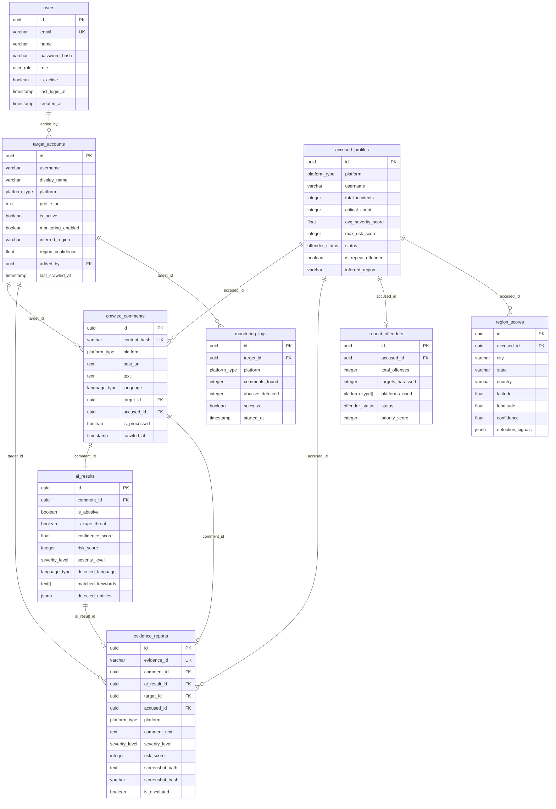

# PATROL — Database Design
> **For AI Agents:** Complete schema reference. Read before writing any DB query or migration.

## Schema Overview (Mermaid ER Diagram)



---

## Table Reference

### `users`
Admin and analyst accounts. Passwords stored as bcrypt hashes (never plaintext).
- Roles: ADMIN (full), ANALYST (read+write), VIEWER (read-only)
- JWT tokens reference `users.id`

### `target_accounts`
Women influencers/public figures being monitored.
- One row per (username, platform) combination
- `monitoring_enabled` = false pauses crawling without deleting
- `last_crawled_at` updated after each crawler run

### `accused_profiles`
Unique offender profiles normalized across all incidents.
- One row per (username, platform) — not per incident
- `total_incidents`, `avg_severity_score`, `max_risk_score` updated via trigger or service
- `is_repeat_offender` = true when total_incidents >= 3

### `crawled_comments`
Raw data from all platform crawls. Deduplicated by `content_hash` (SHA256 of platform+comment_id+text).
- `is_processed` = false until AI pipeline runs
- Full-text search via `pg_trgm` index on `text`
- JSON `raw_data` stores platform-specific fields

### `ai_results`
One-to-one with `crawled_comments`. Created by AI pipeline.
- Separate boolean per abuse category (easy filtering)
- `matched_keywords` array stores which lexicon words triggered
- `detected_entities` JSONB: `{persons: [], locations: [], phones: []}`

### `evidence_reports`
Legal evidence packages. Created when AI detects abuse.
- `evidence_id` = human-readable ID (e.g., `EVD-2024-001234`)
- `screenshot_path` = relative path in storage directory
- `screenshot_hash` = SHA256 of screenshot file (integrity)
- `chain_of_custody` JSONB records all access/actions

### `repeat_offenders`
Populated when accused_profiles.total_incidents >= 3.
- `priority_score` computed from: total_offenses × severity_weights
- Used for dashboard "Repeat Offenders" page

### `monitoring_logs`
Audit trail for every crawler run. Never deleted.

### `region_scores`
Geographic inference per accused profile.
- `detection_signals` JSONB example:
  ```json
  {
    "bio_keywords": ["Jaipur", "राजस्थान"],
    "hashtags": ["#Jaipur"],
    "language_region": "Rajasthani Hindi",
    "confidence_factors": {...}
  }
  ```

---

## Key Queries

### Dashboard Stats
```sql
SELECT
    (SELECT COUNT(*) FROM target_accounts WHERE is_active = TRUE) AS active_targets,
    (SELECT COUNT(*) FROM evidence_reports 
     WHERE created_at > NOW() - INTERVAL '24 hours') AS evidence_24h,
    (SELECT COUNT(*) FROM evidence_reports 
     WHERE severity_level = 'CRITICAL') AS critical_total,
    (SELECT COUNT(*) FROM repeat_offenders 
     WHERE status = 'CONFIRMED') AS repeat_offenders;
```

### Recent Evidence Feed (Dashboard Live Feed)
```sql
SELECT er.*, ta.username AS target_username, ap.username AS accused_username
FROM evidence_reports er
JOIN target_accounts ta ON er.target_id = ta.id
JOIN accused_profiles ap ON er.accused_id = ap.id
WHERE er.severity_level IN ('HIGH', 'CRITICAL')
ORDER BY er.created_at DESC
LIMIT 50;
```

### Region Threat Map Data
```sql
SELECT 
    rs.state, rs.city, rs.latitude, rs.longitude,
    COUNT(er.id) AS incident_count,
    COUNT(CASE WHEN er.severity_level = 'CRITICAL' THEN 1 END) AS critical_count
FROM region_scores rs
JOIN accused_profiles ap ON rs.accused_id = ap.id
JOIN evidence_reports er ON er.accused_id = ap.id
WHERE rs.latitude IS NOT NULL
GROUP BY rs.state, rs.city, rs.latitude, rs.longitude
ORDER BY incident_count DESC;
```

### Unprocessed Comments (AI Worker Query)
```sql
SELECT id, text, platform, target_id, accused_id
FROM crawled_comments
WHERE is_processed = FALSE
ORDER BY crawled_at ASC
LIMIT 100
FOR UPDATE SKIP LOCKED;  -- Critical: prevents duplicate processing
```

### Repeat Offender Detection
```sql
UPDATE accused_profiles
SET is_repeat_offender = TRUE
WHERE total_incidents >= 3
  AND is_repeat_offender = FALSE
RETURNING id, username, platform, total_incidents;
```

---

## Indexes Summary

| Table | Index | Type | Purpose |
|-------|-------|------|---------|
| `crawled_comments` | `text` | GIN trgm | Full-text search |
| `crawled_comments` | `text` | GIN FTS | PostgreSQL text search |
| `ai_results` | `risk_score DESC` | BTree | Dashboard top threats |
| `evidence_reports` | `created_at DESC` | BTree | Chronological feed |
| `accused_profiles` | `max_risk_score DESC` | BTree | Top offender ranking |

---

## Migration Strategy

- Migrations in `backend/database/migrations/`
- Naming: `001_initial_schema.sql`, `002_add_doxxing_flag.sql`, etc.
- Apply with: `alembic upgrade head`
- Never edit `schema.sql` directly after first deployment — create migrations

---

## Connection Pool Config

```python
# database/connection.py

engine = create_async_engine(
    settings.DATABASE_URL,
    pool_size=10,           # 10 persistent connections
    max_overflow=20,        # 20 additional overflow connections
    pool_timeout=30,        # Wait max 30s for connection
    pool_recycle=3600,      # Recycle connections hourly
    echo=settings.DEBUG,    # Log SQL in debug mode
)
```